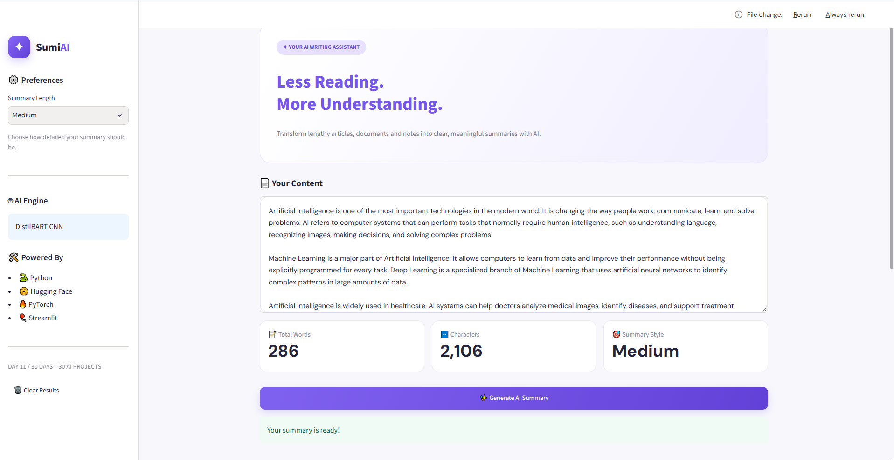
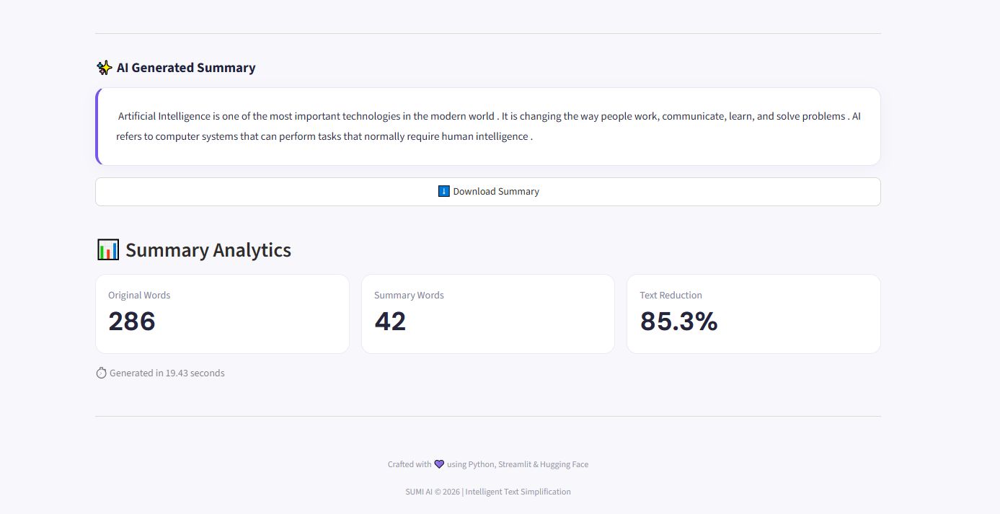
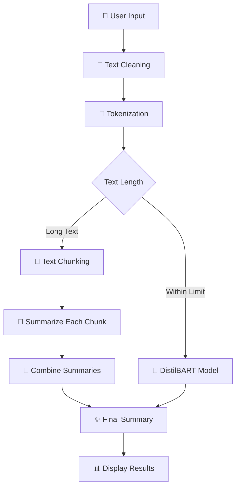

<div align="center">

# ✨ Sumi AI
### AI-Powered Text Summarizer

**Less Reading. More Understanding.**

Transform lengthy articles and documents into clear, concise, meaningful summaries using Artificial Intelligence.

<br/>


</div>

---
## 🖼️ Application Preview

<div align="center">

### 🏠 Main Interface



### ✨ AI Generated Summary



**Sumi AI – Less Reading. More Understanding.**

</div>

## 📌 Overview

Sumi AI is an AI-powered text summarization application that converts lengthy text into shorter, meaningful summaries.

It uses the **DistilBART CNN model** from Hugging Face Transformers to understand input text and generate summaries while preserving important information.

Whether you're reading articles, study materials, or lengthy documents, Sumi AI helps you understand the key points faster.

---

## ✨ Features

- 🤖 **AI-Powered Summarization** – Uses a pretrained DistilBART model.
- 📝 **Multiple Summary Lengths** – Choose Short, Medium, or Long summaries.
- 🧩 **Long Text Processing** – Splits lengthy text into manageable chunks.
- 📊 **Text Analytics** – Displays word and character counts.
- ⚡ **Processing Time** – Measures summary generation time.
- 🎨 **Clean UI** – Modern, user-friendly Streamlit interface.
- 🧹 **Clear Results** – Reset your previous summary easily.

---

## 🧠 How Sumi AI Works

The application follows a simple AI summarization pipeline.



### 🔍 Processing Steps

1. **Input:** User enters text into the application.
2. **Cleaning:** Unnecessary spaces and formatting are removed.
3. **Tokenization:** Text is converted into tokens.
4. **Chunking:** Long text is divided into smaller sections.
5. **Summarization:** DistilBART generates summaries.
6. **Combination:** Individual summaries are combined when necessary.
7. **Output:** The final summary is displayed to the user.

---

## 🛠️ Tech Stack

| Technology | Purpose |
|---|---|
| Python | Core programming language |
| Streamlit | Interactive web application |
| Hugging Face Transformers | Pretrained summarization model |
| DistilBART CNN | AI text summarization |
| PyTorch | Deep learning framework |

---

## 🤖 AI Model

**Model:** `sshleifer/distilbart-cnn-12-6`

DistilBART is a distilled version of BART, designed to provide efficient text summarization.

**Key details:**
- Model source: Hugging Face
- Task: Abstractive Text Summarization
- Architecture: Transformer
- Pretrained on CNN/DailyMail summarization data

The model is downloaded automatically when the application runs for the first time.

---

## 📂 Project Structure

```text
AI-Text-Summarizer/
│
├── app.py
├── summarizer.py
├── requirements.txt
├── README.md
│
└── assets/
    └── sumi-ai-preview.png
```

---

## ⚙️ Installation & Setup

### 1. Clone the Repository

```bash
git clone https://github.com/21vicky/AI-Text-Summarizer.git
```

### 2. Navigate to the Project

```bash
cd AI-Text-Summarizer
```

### 3. Create a Virtual Environment

```bash
python -m venv venv
```

### 4. Activate the Environment

**Windows:**

```bash
venv\Scripts\activate
```

### 5. Install Dependencies

```bash
pip install -r requirements.txt
```

### 6. Run the Application

```bash
streamlit run app.py
```

The application will open in your browser.

---

## 🖼️ Application Preview

Add your application screenshot below:

<div align="center">


* Sumi AI – AI-powered text summarization interface *

</div>

---

## 🔮 Future Improvements

- 📄 PDF document summarization
- 🌐 URL and article summarization
- 🌍 Multilingual summarization
- 📥 Download summaries as TXT or PDF
- ⚡ Improved processing performance

---

## 🎯 Learning Outcomes

Through this project, I explored:

- Working with pretrained Transformer models.
- Understanding abstractive text summarization.
- Using Hugging Face pipelines.
- Processing long text using tokenization and chunking.
- Building interactive AI applications with Streamlit.
- Integrating PyTorch with NLP applications.

---

## 👨‍💻 Developer

<div align="center">

### Vignesh U

Aspiring AI & ML Engineer | Full Stack Developer

[](https://github.com/21vicky)

**Built with ❤️ and Python**

</div>